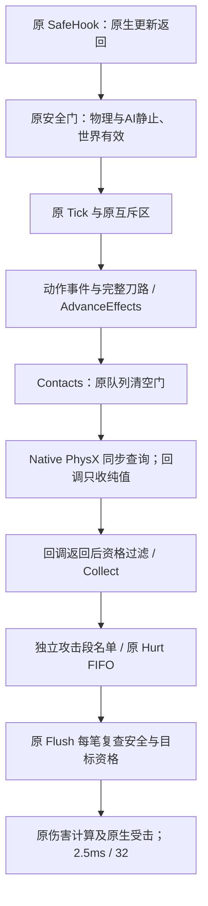

# 087：查询消费工作量优化与可关闭的分阶段诊断

本轮源码0.4.38，代码合同`IRIS_CONTACT_WORK_087`。当前真实DLL仍0.4.37/086，未编译、未部署。正式版2.0保持。

## 证据与本轮范围

关闭断肢后的完整窗口27～28中，safe_tick累计1040.6227ms；不重复相加的物理查询占52.0%，未细分战斗逻辑25.2%，特效创建7.5%、更新5.2%、原生受击6.1%。范围是插件已测安全更新墙钟，不是全游戏CPU/FPS/GPU。新旧战斗不同，不能把这些比例当作优化收益。

本轮只减少已可证明冗余的查询后处理及采样位置计算，补足下一步归因。**不改物理查询算法/次数/半径/位移/刀路/形体类型，不引入调度延迟。**胶囊自适应分组、排序替换和对象池扩张仍待新阶段测量，不据推测直接修改。

## 调用链与所有权



远程环境仍是有限射线，沿本机原生Harpoon飞行组`0x087FDE47`与调用组取交集；角色仍连续带半径球扫掠，光炮仍原平端圆柱。原生证据见本会话NativeTerrain077、NativeMeleeEligibility任务和既有`docs/native-terrain077.md`。本轮实际校验查询调用/参数/过滤与失败重试不变，不照搬原生worker线程模型。

所有NxShape/NxActor仍只借同步查询栈，不增加跨帧物理事实或人物裸指针缓存。新诊断复用原诊断锁，Scope只在SDK调用返回后提交，**不在PhysX回调内拿插件锁或执行医疗**；无新Hook/线程/后台调用。

## 实际优化

1. `RangedContactMemo`：旧相邻身份快路保留，追加16槽固定纯值直接映射。完整比较present/type/container/containerSerial/index/serial；哈希冲突重新判定，覆盖只减少复用机会，不丢结果/不分配。每次接触消费新建，绝不跨飞弹/查询/帧使用关系结论。最近有效目标、环境同距优先、排序原样。
2. `Collect`：本攻击段victims已包含的身份，旧逻辑即使之后资格变化也不会撤销该成员；所以省掉重复解引用、资格判断与插入。不缓存拒绝结果，不跨攻击段共享名单；最终医疗前原资格门、稳定身份、世界代次检查不变。角色后来死亡/失效/改关系仍由最终门处理。
3. `Visual::Draw`：同龄源层只计算一次采样lo/hi/u，25维轨道插值与所有custom输出仍逐层计算；真实layerAge不同则使用原表达式。年龄/颜色/透明度/几何/时钟/显隐/寿命不变。该计数表示源代码省掉的重复工作，不是已测机器指令或FPS收益。

## 配置及日志解释

启动配置均位于`[IrisArsenal]`，修改后重启。新增`EnableCollisionDetailProfiling`程序缺省0，distribution和待更新package显式1；没有改真实游戏INI。

```ini
EnableLogging=1
EnablePerformanceLogging=1
EnableCombatDetailLogging=1
EnableCollisionDetailProfiling=1
```

只关本轮诊断：`EnableCollisionDetailProfiling=0`。关闭总日志`EnableLogging=0`也会关闭新诊断。关闭时新增Scope不读QPC、不提交统计或取诊断锁；优化与原预算时钟仍生效。其余旧诊断仍由各自旧开关控制。

启动确认`contact_work_ready contract=IRIS_CONTACT_WORK_087 collision_profile=1`，以及实际日志/PE版本0.4.38，才能判定新DLL已加载。

| 新通道 | 含义 |
|---|---|
| native_terrain_ray | 原地形SDK射线及其纯值回调 |
| native_sphere_sweep | 原连续球扫掠及其纯值回调（也可服务翻滚，并非仅角色） |
| sweep_result_finalize | 原唯一接触完整性检查和原排序 |
| capsule_candidates / capsule_exact / capsule_results | 原合批广相 / 回调外精确检查 / 各路径身份结果分发 |
| contact_collect / ranged_filter | 原近战名单收集 / 远程最近有效接触资格消费 |
| path_build / damage_enqueue | 原完整刀路生成 / 原逐目标FIFO请求准备 |
| attachment_update / trail_update | 原附件及刀光更新，包含已有可视子计时 |

窗口与进程摘要每轮各追加12个计时通道；新增十项计数在原audit_counters中输出，不新增逐形体日志、不从每个回调写文件。旧明细日志由旧开关控制，本轮不新增全局行数截断。原父计时和这些子计时有嵌套，不能相加。

重点看`collect_contacts = collect_already_accepted + collect_policy_checks`、`collect_inserted`、`ranged_contact_checks/reuses`与`ranged_memo_collisions`。冲突并非错误，只代表重算资格。`terrain_ray_raw/sphere_sweep_raw/sweep_sorted_contacts`描述查询实际工作量；`paths_built`用于确认未削减刀路，`curve_sample_reuses`用于确认共享位置计算是否命中。零调用/失败仍有原重试诊断，所有旧安全窗口和等待归因保持。

## 验证与边界

- 实际C++ AST解释：38988次资格查询，76个输入流；强制哈希冲突、全身份字段差异、相邻/交错重复均与旧资格结果一致。交错两身份200次输入，资格调用200→2，仅为合成输入工作量，非运行耗时。
- 96组收集名单/日志开关组合一致，已接受后资格改变和超256接触覆盖；不缓存拒绝结果。
- 336组float32采样位置（单帧、边界、夹取及不同层年龄）对照一致。轨道插值及Shader提交表达式保持。
- 93个其余战斗函数逐token保持；原SDK参数/消费者、物理安全门/医疗FIFO保持。7种重入状态、100目标FIFO、102目标时间预算和9种代次条件规格通过。
- 14份C++/H非编译语法检查通过。解析器不支持的合法MSVC属性及既有成员指针typedef只在解析输入中规范化，不改产品源码；不能代替MSVC类型/链接验证。
- 更新隔离测试20通过/1系统符号链接权限跳过；实际旧DLL被087合同拒绝，不生成假PE或新DLL。真实游戏135份清单哈希全部一致。

未运行MSVC、引擎PhysX、Windows线程或游戏；不承诺FPS改善。用户编译`IrisArsenal.sln`的`Release|x64`（v100）后，正常退出游戏执行原`UpdateMod.cmd`。更新仍是原清空并整包复制流程，只追加既有DLL合同检查；没有增加资源重建步骤。

## 文件、备份与恢复

逐文件报告和实际验证在本会话`Task-Iris-Contact087-20261024-105216-676167`。修改前双备份：`D:/CodexBackups/Task-Iris-Contact087-20261024-105216-676167`和`E:/AIWorkSpace/_backups/Task-Iris-Contact087-20261024-105216-676167`，保留原盘符/路径；修订副本单独存revision子目录，不覆盖首份。CPP/H保持UTF-8无BOM、CRLF；RC/Python/INI/JSON/STATE保留原LF，中文回读检查通过。新文件UTF-8/LF。

恢复源码时按本任务before或双备份逐路径恢复；游戏和用户bin仍是原0.4.37，本轮无需回滚。工作包ready=false/pending0.4.38，不把旧DLL标成新优化。FCS、全部资产、医疗探针、两个外部插件及正式版归档均未修改。
