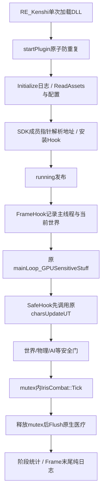

# 架构与原生调用链

## 分层和职责

| 模块 | 实际职责 | 不应越界的职责 |
|---|---|---|
| IrisArsenal.cpp | RE_Kenshi入口、Hook、武器预筛、原生选招结果、主线程安全窗口、复位/关闭、显式DrillProofOnly原型 | 不在渲染帧末尾随意增加医疗或PhysX |
| IrisCombat.cpp | 十招私有技巧、Actor时序、附件/后效、Emit、弹体、Job、Hurt FIFO、原生受击桥接、近战防御/反应适配 | 不伪造角色移动、血量或全局阵营 |
| IrisRanged.cpp | 同一近战武器的HybridGun能力、原生AI适配、实际持械/原生瞄准许可、延迟回收 | 不把库存武器直接冒充Crossbow对象 |
| native/NativeMultiContact.cpp | PhysX 2.8.4查询、完整稳定身份、结果收集/去重、原生分组地形射线、批量路径 | 不保存跨帧NxShape/NxActor裸指针 |
| IrisDiagnostics / NativeAudit / WoundAudit | 窗口、阶段、Hook、资源与原生医疗子树归因 | 不以日志时长冒充FPS、GPU或实际扣血 |
| author_* / source_* / *_069等工具 | 离线骨架、FCS、网格、材质/曲线、来源与验证 | 日常Update不能隐式重建/覆盖用户修正 |
| package / distribution / compatibility / workshop | 运行资产、配置模板、独立补丁、发布素材 | 主FCS不混入第三方种族补丁 |

## 启动与安全主循环

原生已取证主循环：停止物理线程 → processKillList → Physics.updateUT移交创建/销毁等消息 → charsUpdateUT → 后续玩家/保存/布娃娃工作 → 再启动物理。物理线程没运行不等于消息全部处理完；不能为缩短等待强制清空/执行后台消息。原生路径证据见封存evidence/NativeQueueLifecycle与原任务的PE反汇编。

SafeHook限定已识别主线程、当前FrameScope世界、每帧一次；Idle检查世界初始化/重置/读档、physics及AI线程状态。未消费游戏dt会累积为deferredDelta，恢复安全Tick时推进；暂停不累积游戏时间。Tick持原mutex，Flush必须锁外调用可重入的原生受击；逐笔重新查安全状态，不保存跨帧“许可证”。证据：`IrisArsenal.cpp:455`（FrameHook）、`IrisArsenal.cpp:449`（Idle）、`IrisArsenal.cpp:501`（SafeHook）、`IrisCombat.cpp:1942`（Flush）。

## 原生近战与本项目替换点

原生CharStats::chooseAttack/_chooseAttacks会考虑类别、技巧候选、站姿/趴地、上一次招式、距离/武器触及、静止、技能/负重以及MedicalSystem::scoreTechnique等。各参数并非四个互相独立的开关；具体含义应从对应游戏版本调用者取证，不能仅按英文变量名下结论。

本项目：ChooseHook先且仅调用一次原chooseAttack(stats,range,reach,last,stationary) → 实际专用武器stringID预筛 → 原mutex内复核 → NativeStandingMeleeAllowed → IrisCombat::Choose距离/权重/就绪选择私有技巧 → 失败返回已经取得的原生结果。私有选择继续使用range，没有逐项复刻reach/last/stationary评分；这是武器专属设计，不能声称原生全部选招条件完全相同。原生NULL也可能只是普通攻击够不到，满足身体资格时仍允许专属较远招式。

原生attackState已取证顺序：calculateCurrentTechniqueSection → calculateTargetsInAttackZone → attackImpactCheck → 后续段/收招判断。本项目额外特效伤害不直接把整个任意球/柱交给此原生技巧攻击区，因为它还绑定原生技巧分段、防御、轨迹与内部名单语义。项目另建命中事实后沿原生受击链，不复制原生完整战斗状态机。

## 原生远程与适配点

原生：AI判断远程能力/评分/射程 → RangedCombatClass选敌、转向、装备、getGun、瞄准与takeTheShotCheck → GunClass::shoot → 原生弩弹/Tracer。是否射得中、是否会主动换位，不应只凭UI“坚守”推断；用户也观察到原生会原地射向障碍，本项目没有承诺重写其走位。

本项目：能力Hook发现专用武器 → 安全Prepare创建独占HybridGun/Slot → Publish实际炮口与可用状态 → 原生MT瞄准/许可 → ShotHook只提交稳定目标，不生成原弩弹 → 安全Tick选本次专属远程并startCombatAnimation → Emit按同一实际炮口重新CaptureAim（火神/脉冲用本次固定弹速，光柱用原生身体点即时方向）→ 独立碰撞 → 医疗。不能在原生开火前再加一个未经要求的弹速/方向匹配门，否则会出现完全不开枪。

远程仍复用_NV_hitByMeleeAttack，不是Harpoon/iShotYou弩弹结算；三招没有额外跳格挡/闪避覆盖，真实返回值以日志确认。角色射击出发点由实际附件变换决定，统一瞄准点不等于把枪口搬到头部。证据：`IrisRanged.cpp:344`（Publish）、`IrisRanged.cpp:314`（CaptureAim）、`IrisCombat.cpp:1273`（Emit）及docs/shared-aim-060.md、ranged-start-062.md。

## 从命中到医疗

Emit/飞行接触 → Job（caster、cast、event、move、几何、直接命中稳定身份）→ ResolveJobs收集/过滤/同事件去重 → Hurt FIFO → Flush逐笔世界/暂停/物理/AI/身份/资格检查 → stats->getTotalAttackDamageFor(victim) → damage.multiply(该段倍率) → 一次_NV_hitByMeleeAttack → 原防御/部位/护甲/MedicalSystem::addWound/applyDamage及可能的amputate/物品/外观/布娃娃 → 原经验及结果记录。

同一原生受击可耗数毫秒甚至更多，20ms是调用之间检查的软预算，不能抢占正在执行的截肢。不能将批次耗时当成单次，也不能把提交的护甲前伤害当实扣HP。证据：`IrisCombat.cpp:1078`（ResolveJobs）、`IrisCombat.cpp:1942`（Flush）、IrisNativeAudit.cpp、IrisWoundAudit.cpp。
